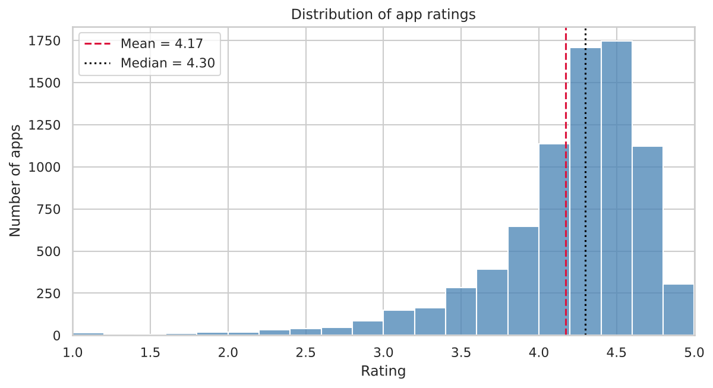
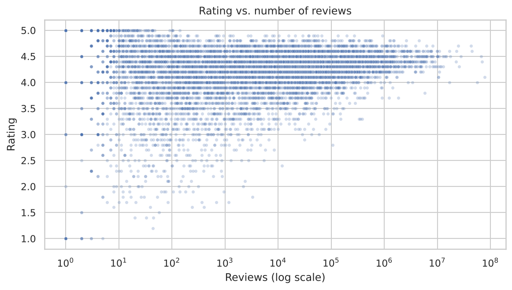
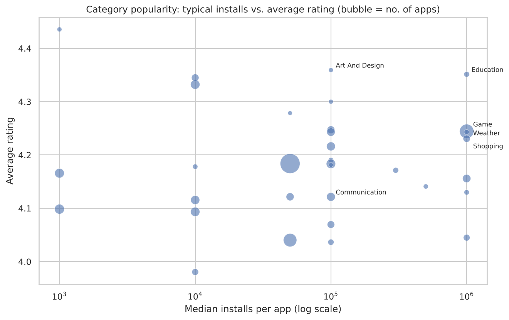

# Google Play Store Apps: Market Analysis

Descriptive analysis of ~10.8K Google Play Store listings: the raw export is cleaned into an analysis-ready dataset, then used to answer business questions for a client planning to launch an Android app.

**Tools:** Python · pandas · NumPy · matplotlib · seaborn · SciPy  
**Skills:** data cleaning · exploratory data analysis · data visualisation · hypothesis testing · confidence intervals

---

## The brief

A client planning to launch an Android app wants to understand the Play Store market before deciding **what to build and how to price it**. The deliverables:

1. A clean, analysis-ready dataset
2. A visual overview of the market: categories, free vs. paid, ratings, installs
3. Answers to specific business questions on pricing, popularity, growth and rating reliability

## Data

[Google Play Store Apps](https://www.kaggle.com/datasets/lava18/google-play-store-apps) (Kaggle), scraped in 2018. 10,841 rows × 13 columns: app name, category, rating, reviews, size, installs, type, price, content rating, genres and release information.

## Data cleaning

| Issue found in the audit | How I handled it |
|---|---|
| 1 corrupted row (values shifted one column, rating = 19) | Removed — the true category cannot be recovered |
| 1,181 duplicate listings of the same app | Kept the listing with the most reviews (latest snapshot) → **9,659 unique apps** |
| Numbers stored as text (`19M`, `10,000+`, `$4.99`) | Converted Size to MB, Installs, Price and Reviews to numeric, dates to datetime |
| Rating missing for ~15% of apps | **Not imputed.** These apps have a median of 1 review, so they are unrated rather than erroneous. Imputing would distort the confidence interval and t-test, so a `Rated` flag is added instead |
| Low-rating outliers (6% of rated apps, below 3.25) | Kept and flagged: valid ratings of genuinely poor apps |
| Small gaps in Type, Current Ver, Android Ver | Filled: `Free` (the app costs $0) and `Unknown` |

## Key findings

**1. The rating bar is high.** The median app scores 4.3, and the 95% confidence interval for the mean rating is [4.16, 4.19]. A new app needs 4.5+ to stand out.



**2. Perfect ratings are a small-sample effect.** 99% of the 271 apps rated 5.0 have fewer than 100 reviews (median: 4). Ratings only settle into the 4.0–4.6 range once an app has thousands of reviews.



**3. Crowded is not the same as rewarding.** Family, Game and Tools have the most apps. Education, Game, Weather and Shopping combine high typical installs (~1M per app) with strong ratings.



**4. Free dominates, and price is unrelated to size.** ~92% of apps are free. Paid apps cluster in niche categories (Personalization, Medical, Books & Reference). Price and app size are uncorrelated (Spearman ρ = 0.05, p = 0.24).

**5. Paid apps rate slightly higher.** 4.26 vs. 4.17 (Welch t-test p ≈ 0.0001, confirmed by Mann–Whitney), but the effect size is small (Cohen's d = 0.18).

**6. Maintained apps win.** Apps updated in the last 3 months average 4.25 stars and a median of 500K installs, vs. 10K installs for apps not updated in over 3 months.

## Business questions answered

| Question | Answer |
|---|---|
| Does price correlate with app size? | No (Pearson r = −0.07, Spearman ρ = 0.05) |
| Which categories are most popular? | Education, Game, Weather, Shopping, Art & Design (installs + rating) |
| How many apps are produced per year? | Growth every year since 2010; 2018 peaks with 6,287 apps (led by Family, Game, Tools) |
| Highest-priced apps with a good rating? | Premium games and specialist tools at $10–$25 (rating ≥ 4.5, 100+ reviews) |
| Are top-rated apps genuine? | Mostly not: 5.0 ratings come from tiny review counts |
| Why can low-review apps rate so high? | Small samples, friends and family reviews, early adopters, incentivised reviews |
| 95% CI for the average rating? | [4.16, 4.19] |
| Do free and paid apps differ in rating? | Yes, significantly but slightly (d = 0.18) |

## Recommendations

- Launch **free** (with in-app purchases or a premium tier), unless targeting a specialist niche where users pay for a clear function.
- Target categories with **high demand per app and high satisfaction** (Education, Weather, Shopping) over the most crowded ones (Family, Tools).
- Plan for a **4.5+ rating** and an **update at least every 3 months**.
- Judge competitors' ratings together with review counts, and ignore perfect scores under ~100 reviews.

## Repository structure

```
google-playstore-data-munging/
├── README.md
├── google_playstore_analysis.ipynb   # full analysis, runs top to bottom
├── data/
│   └── googleplaystore.csv
└── figures/                          # charts used in this README
```

## How to run

```bash
pip install pandas numpy matplotlib seaborn scipy jupyter
jupyter notebook google_playstore_analysis.ipynb
```

---
**Urvee Shrivastava** · [GitHub](https://github.com/Urvee1810)
